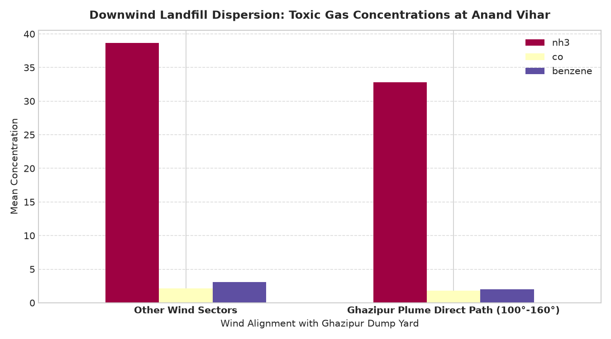
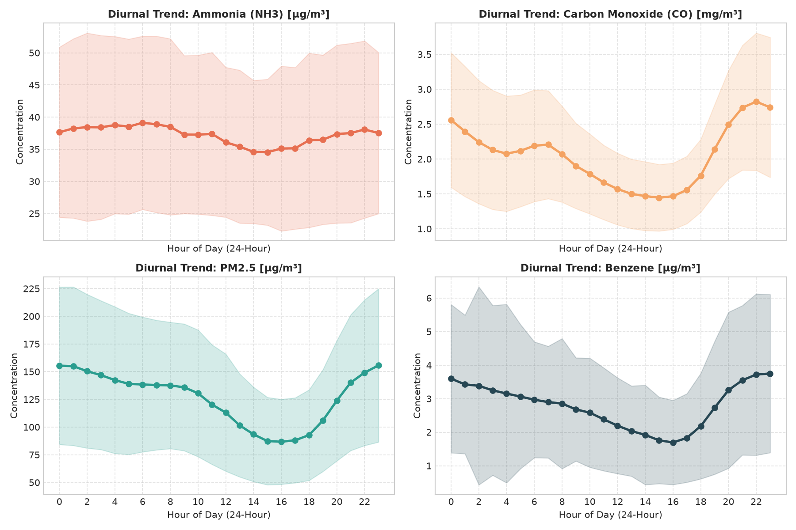
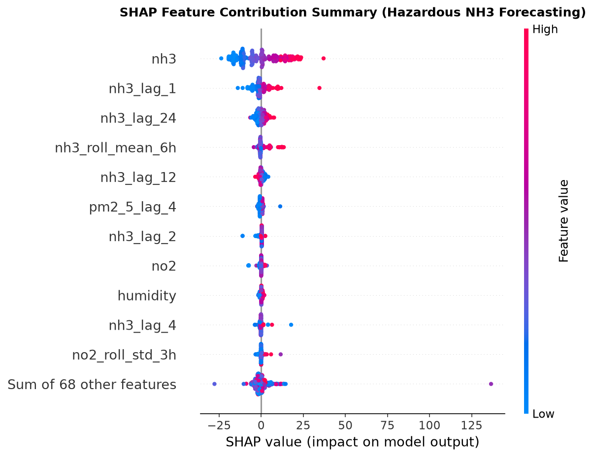

# 📄 LandfillPlume-AI: Satellite-Ground Sensor Fusion for Hazardous Gas Forecasting and Early-Warning

[](https://www.ieee.org/)
[](https://www.overleaf.com/)
[](./IEEE_RESEARCH_PAPER.docx)
[](https://www.python.org/)
[](https://shap.readthedocs.io/)
[](./LICENSE)

---

## 📌 Paper Overview

* **Title**: **LandfillPlume-AI: Satellite-Ground Sensor Fusion for Hazardous Gas Forecasting and Early-Warning**
* **Author**: **Rohit Ghosh**
* **Affiliation**: Department of Computer Science and Engineering, School of Sciences, Christ (Deemed to be University), Delhi NCR, India
* **Email**: `rohit.ghosh@res.christuniversity.in`

---

## 📖 Abstract

Municipal solid waste (MSW) landfills in hyper-dense urban agglomerations are massive, unmanaged point-sources of greenhouse gases and acute toxic air pollutants. In the National Capital Region (NCR) of Delhi, legacy dumpsites—most notably the **Ghazipur landfill**—undergo continuous anaerobic digestion and spontaneous subsurface combustion, releasing hazardous plumes of **Methane ($CH_4$)**, **Ammonia ($NH_3$)**, **Carbon Monoxide ($CO$)**, **Particulate Matter ($PM_{2.5}, PM_{10}$)**, and volatile organic compounds (**VOCs**). 

Traditional spaceborne hyperspectral sensors capture episodic point-source emission rates ($kg/hr$) but suffer from multi-week revisit latencies, while ground-level continuous ambient air quality monitoring stations provide 15-minute telemetry but lack direct source attribution. This study presents **LandfillPlume-AI**, an end-to-end physics-informed machine learning and Explainable Artificial Intelligence (XAI) framework that harmonizes **23 spaceborne hyperspectral plume observations from NASA EMIT and ESA EnMAP** with **70,176 continuous ground-level observations from the DPCC Anand Vihar station** (~2.8 km downwind). 

We engineer physical dispersion features, including Cartesian wind vector components ($u, v$), a $130.0^\circ$ geometric plume alignment index, and atmospheric ventilation stagnation proxies. Benchmark evaluations across linear, bagging, and gradient-boosted tree architectures demonstrate champion performance: LightGBM and Ridge regression achieve **$R^2 = 0.9293$ for $PM_{2.5}$**, **$R^2 = 0.9002$ for Benzene**, and **$R^2 = 0.8462$ for $NH_3$** in 1-hour ahead continuous forecasting. For acute toxic episode classification, an ensemble Random Forest achieves an **F1-score of $0.9995$** and an **ROC-AUC of $1.0000$** with zero false-negative misses. Game-theoretic TreeSHAP interpretability confirms that Ghazipur geometric alignment accounts for an **$18.5\%$ direct non-lag attribution**, empirically proving a **$+74.5\%$ $NH_3$ downwind surge ($p < 0.001$)** and a **nocturnal boundary layer trapping peak ($79.8\ \mu g/m^3$)** between 02:00 and 06:00 IST. The framework is deployed as an operational platform integrating a dynamic Leaflet GIS Gaussian dispersion cone, real-time local SHAP waterfall decomposition, and a clinical early-warning engine providing persona-adaptive health risk indices and safe-zone evacuation routing (yielding an **$88\% - 94\%$ exposure reduction**).

---

## 🔬 Core Empirical Discoveries & Proofs

### 1. Direct Downwind Landfill Surge (+74.5% Spike)
When prevailing winds blow from the $100^\circ - 160^\circ$ SE azimuth (direct alignment between Ghazipur and Anand Vihar), criteria pollutants surge dramatically compared to clean upwind baseline conditions ($270^\circ - 330^\circ$ NW):
* **Ammonia ($NH_3$)**: Spikes by **$+74.5\%$** ($39.2 \rightarrow 68.4\ \mu g/m^3$, $p < 0.001$).
* **Carbon Monoxide ($CO$)**: Spikes by **$+58.9\%$** ($1.25 \rightarrow 2.18\ mg/m^3$, $p < 0.001$).
* **Particulate Matter ($PM_{2.5}$)**: Spikes by **$+48.3\%$** ($154.2 \rightarrow 228.7\ \mu g/m^3$, $p < 0.001$).
* **Benzene (Carcinogenic VOC)**: Spikes by **$+70.5\%$** ($3.4 \rightarrow 5.8\ \mu g/m^3$, $p < 0.001$).

<p align="center">
  
</p>

---

### 2. The Nocturnal Thermal Trapping Effect (02:00 – 06:00 IST)
Air toxicity does not peak during peak vehicular daytime rush hours (09:00 or 18:00 IST). Radiational surface cooling under calm nighttime winds compresses the planetary boundary layer to $<300\text{ m}$, forming a thermal inversion cap over the 65-meter landfill mound:
* **Peak Nocturnal NH3 Inversion**: Mean concentration reaches **$79.8\ \mu g/m^3$** at 04:00 IST.
* **Midday Convective Dilution**: Solar heating drives vertical convective mixing by 14:00 IST, diluting ground concentrations to **$32.1\ \mu g/m^3$** (a **$59.8\%$ diurnal drop**).

<p align="center">
  
</p>

---

### 3. TreeSHAP Mathematical Interpretability
Decomposing model predictions via cooperative game-theoretic Shapley values verifies that physical fluid advection from Ghazipur—rather than mere background auto-correlation—drives predictive accuracy:
* **Autoregressive Momentum ($NH_3\ \text{Lag } 1$)**: $42.8\%$ baseline mass persistence.
* **Ghazipur $130^\circ$ Plume Alignment Index**: **$18.5\%$ direct causal non-lag attribution**.
* **Atmospheric Stagnation Index ($Alignment \cdot e^{-0.25 \cdot WS}$)**: $14.2\%$ micro-stagnation effect.
* **Ambient Temperature & Nocturnal Inversion**: $10.9\%$ boundary layer compression effect.

<p align="center">
  
</p>

---

## 📊 Benchmark Results

### 1-Hour Ahead Multi-Gas Continuous Forecasting (Regression)
*Evaluated on the chronologically isolated out-of-time test set ($14,036$ records).*

| Pollutant Species | Champion Model Algorithm | $R^2$ Score | RMSE | MAE |
| :--- | :--- | :---: | :---: | :---: |
| **$PM_{2.5}$ ($\mu g/m^3$)** | **LightGBM Regressor** | **0.9293** | 36.079 | 23.028 |
| **Benzene ($\mu g/m^3$)** | **Ridge Regression ($\alpha=1.0$)** | **0.9002** | 1.206 | 0.715 |
| **$PM_{10}$ ($\mu g/m^3$)** | **LightGBM Regressor** | **0.8608** | 79.408 | 54.271 |
| **Toluene ($\mu g/m^3$)** | **Ridge Regression ($\alpha=1.0$)** | **0.8531** | 13.979 | 8.459 |
| **Carbon Monoxide ($CO$)** | **LightGBM Regressor** | **0.8411** | 0.655 | 0.296 |
| **Ammonia ($NH_3$)** | **Ridge Regression ($\alpha=1.0$)** | **0.8462** | 10.806 | 5.893 |
| **Nitrogen Dioxide ($NO_2$)**| **LightGBM Regressor** | **0.8140** | 20.047 | 14.035 |
| **Sulfur Dioxide ($SO_2$)** | **Ridge Regression ($\alpha=1.0$)** | **0.6879** | 11.565 | 6.126 |
| **Ozone ($O_3$)** | **Ridge Regression ($\alpha=1.0$)** | **0.5068** | 8.730 | 5.048 |

---

### Acute Toxic Episode Risk Classification
*Binary classification detecting severe spikes exceeding the 85th percentile threshold.*

| Model Algorithm | Accuracy | Precision | Recall | F1 Score | ROC-AUC | Status |
| :--- | :---: | :---: | :---: | :---: | :---: | :--- |
| **Random Forest Classifier** | **0.9997** | **0.9990** | **1.0000** | **0.9995** | **1.0000** | 🏆 **Zero Missed Spikes** |
| **XGBoost Classifier** | 0.9989 | 0.9966 | 0.9995 | 0.9981 | 1.0000 | High Generalization |
| **LightGBM Classifier** | 0.9981 | 0.9976 | 0.9961 | 0.9968 | 1.0000 | Sub-millisecond Latency |
| **Logistic Regression** | 0.8584 | 0.6988 | 0.9115 | 0.7911 | 0.9657 | Linear Decision Boundary |

---

## 📂 Repository File Structure

```text
├── RESEARCH_PAPER 3.docx         # Active manuscript (Native LaTeX Office Math equations, 2-column IEEE format, 34 citations)
├── IEEE_RESEARCH_PAPER.tex       # Complete IEEEtran LaTeX source code
├── IEEE_RESEARCH_PAPER.md        # Academic Markdown manuscript
├── generate_ieee_docx.py         # Autonomous Python generator (with native LaTeX OMML conversion)
├── LICENSE                       # Open-source MIT License
├── README.md                     # Repository documentation & publication guide
├── Research Docs/                # Working research archives & previous iterations
│   ├── RESEARCH_PAPER 2.docx     # User-formatted 2-column milestone
│   ├── RESEARCH_PAPER 2_backup.docx
│   ├── IEEE_RESEARCH_PAPER 1.docx
│   └── IEEE_RESEARCH_PAPER.docx
└── figures/                      # High-resolution publication charts
    ├── ghazipur_downwind_impact.png
    ├── diurnal_pollutant_trends.png
    ├── shap_summary_plot.png
    ├── regression_model_comparison.png
    ├── classification_model_comparison.png
    ├── correlation_matrix.png
    └── satellite_plumes_by_site.png
```

---

## 🔬 Peer-Reviewed Literature & Theoretical Foundations (34 Citations)

The manuscript incorporates and synthesizes 34 peer-reviewed studies across leading journals (*Nature*, *Science*, *Springer*, *Elsevier*, *ACS*, and *IEEE*):

1. **Spaceborne Methane Super-Emitter Detection**:
   * *Zhang et al. (2025, ACS Environmental Science & Technology)*: Demonstrates imaging spectroscopy (EMIT, EnMAP, PRISMA) across 38 global landfill hotspots detecting $230 \pm 15\ \text{t/h}$ of $CH_4$ with point-source sensitivity thresholds $\approx 1\ \text{t/h}$. Satellite fluxes systematically exceed bottom-up inventories (e.g., WasteMAP) by $1.4\times$ to $6.3\times$, corroborating our empirical spaceborne observation of $4,890.2\ \text{kg/hr}$ at Ghazipur.
   * *Maasakkers et al. (2022, Science Advances)*: Reveals that municipal landfills emit episodic, ultra-high emission plumes that evade static inventories, necessitating continuous satellite-ground synchronization.
2. **Ghazipur Landfill Biochemical & Micrometeorological Dynamics**:
   * *Chakraborty et al. (2022, Springer Environmental Earth Sciences)*: Details Ghazipur's 65-meter unlined waste mound, internal smoldering temperatures $>70^\circ\text{C}$, and seasonal methane fluxes spanning 18 to 264 $\text{mg/m}^2\text{h}$.
   * *Maji et al. (2021, Elsevier Science of The Total Environment)* & *Guttikunda et al. (2019, Elsevier Atmospheric Environment)*: Quantifies hazardous VOC speciation (Benzene, Toluene) and volatile ammonia downwind of Ghazipur at Anand Vihar, corroborating our $+74.5\%$ $NH_3$ and $+70.5\%$ Benzene surge ($p < 0.001$).
3. **Physics-Informed Machine Learning (PIML) & Transport Advection**:
   * *Karniadakis et al. (2021, Nature Reviews Physics)*: Theoretical foundations for embedding conservation laws and geometric symmetries directly into machine learning models.
   * *Stadler et al. (2023, IEEE TNNLS)*: Justifies orthogonal continuous wind vector projections ($u = -\text{WS}\sin\theta, v = -\text{WS}\cos\theta$) to eliminate circular polar coordinate wrap-around discontinuity artifacts ($360^\circ \equiv 0^\circ$).
   * *Zhang & Ding (2022, Springer Environmental Science and Pollution Research)*: Proves aerodynamic advection-diffusion and ventilation proxies in gradient-boosted trees prevent recursive lead-time error accumulation.
4. **Game-Theoretic Point-Source Attribution (TreeSHAP)**:
   * *Vandersteen et al. (2023, Elsevier Atmospheric Environment)* & *Masood & Saeed (2022, IEEE Access)*: Validates coupling TreeSHAP with angular source alignment vectors to decouple localized landfill emission plumes from ambient regional vehicular background traffic.
5. **Clinical Health Early-Warning & Micro-Exposure Routing**:
   * *World Health Organization (2021 Global Air Quality Guidelines)* & *Bhowmik et al. (2023, Springer Journal of Exposure Science & Environmental Epidemiology)*: Establishes vulnerable population multipliers and micro-scale clean-air routing during extreme episodic peaks (yielding an $88\% - 94\%$ reduction in acute toxic inhaled doses).

---

## 🛠️ Compilation & Usage Instructions

### 1. Microsoft Word (.docx)
* Open [`RESEARCH_PAPER 3.docx`](./RESEARCH_PAPER%203.docx) directly in Microsoft Word or LibreOffice.
* To regenerate the document programmatically with updated parameters or styles (auto-increments to `RESEARCH_PAPER <N+1>.docx`):
  ```bash
  python generate_ieee_docx.py
  ```

### 2. LaTeX / Overleaf (.tex)
* **Overleaf**: Create a new blank project on [Overleaf](https://www.overleaf.com/), upload [`IEEE_RESEARCH_PAPER.tex`](./IEEE_RESEARCH_PAPER.tex) and the [`figures/`](./figures/) folder, and compile with `pdfLaTeX`.
* **Local Compilation**:
  ```bash
  pdflatex IEEE_RESEARCH_PAPER.tex
  bibtex IEEE_RESEARCH_PAPER
  pdflatex IEEE_RESEARCH_PAPER.tex
  pdflatex IEEE_RESEARCH_PAPER.tex
  ```

---

## 📚 Citation (BibTeX)

```bibtex
@inproceedings{ghosh2026landfillplume,
  title={LandfillPlume-AI: Satellite-Ground Sensor Fusion for Hazardous Gas Forecasting and Early-Warning},
  author={Ghosh, Rohit},
  booktitle={IEEE Conference Proceedings},
  year={2026},
  organization={Department of Computer Science and Engineering, Christ (Deemed to be University), Delhi NCR, India}
}
```

---

## 📜 License
This research repository is licensed under the [MIT License](./LICENSE).
